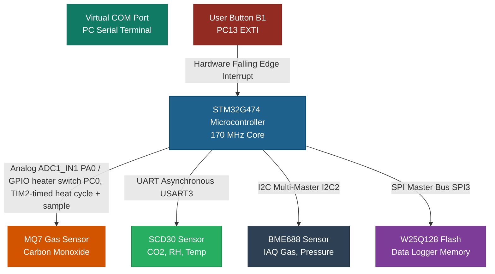
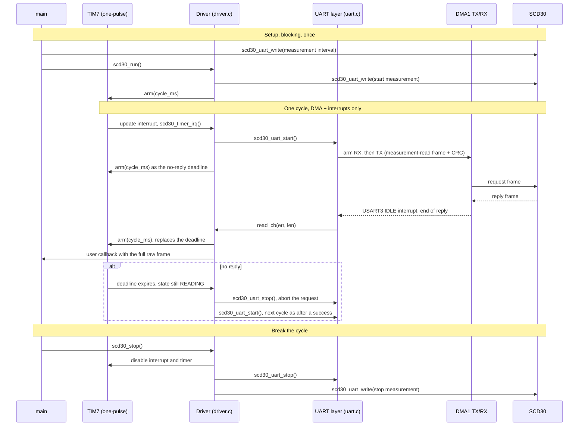
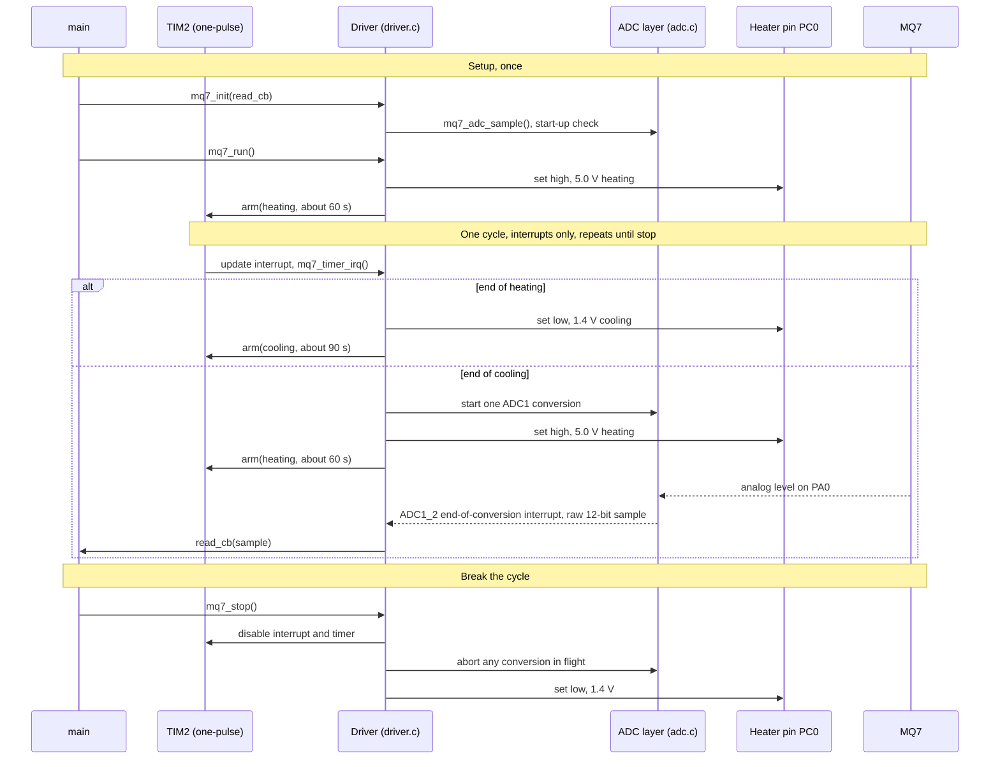

## System Architecture & Interconnect Topology

MetallicBear is a personal learning lab for bare-metal STM32 device driver development, not a product. The goal is to practice writing peripheral drivers from scratch — directly against ST's Low-Layer (LL) register API, with no HAL abstractions and no RTOS — across a progression of bus types (SPI, I2C, UART+DMA, ADC/timers) of increasing complexity.

The project is written in C and targets the NUCLEO-G474RE board (STM32G474RET6). An air-quality sensor array (CO, CO2/RH/temp, IAQ gas) logged to external flash and streamed over a serial console was chosen as a realistic, multi-peripheral vehicle to drive that learning — it gives each driver a concrete communication link, a register/protocol contract, and real timing constraints to get right, rather than being the point of the project itself.

Alongside the driver code itself, part of the exercise is following ST's own conventions for *where* and *how* a driver is structured: peripheral/pin/clock setup stays owned by STM32CubeMX-generated code, and hand-written logic lives in clearly separated `USER CODE` blocks or dedicated BSP modules (see `Drivers/BSP/uv/`), never hand-patched into the generated regions. Sticking to that structure keeps the project regeneration-safe — re-running CubeMX after a pin or clock change merges cleanly instead of clobbering custom code — and is also what ST's tooling (CubeMX, CubeIDE, CubeProgrammer) and ecosystem assume when a project is ported to another board or handed off to someone else.

---

## Hardware Module Interface Mapping

| Module | Core Purpose | Interface Type | Pin Allocation | Electrical Requirements |
| :--- | :--- | :--- | :--- | :--- |
| **MQ7** | Toxic Carbon Monoxide tracking | Analog (ADC) + GPIO switch | PA0 (ADC1_IN1), PC0 (GPIO out, MQ7_HEATER) | 5.0V / 1.4V Dual VCC Cycles |
| **SCD30** | Optical NDIR CO2 monitoring | Asynchronous UART | PB10 (TX), PB11 (RX) [USART3] | 3.3V - 5.5V DC VCC |
| **BME688** | 4-in-1 Volatile Gas/IAQ | I2C Multi-Master Bus | PC4 (SCL), PA8 (SDA) [I2C2] | 1.2V - 3.6V DC VCC (3.3V Typ) |
| **BME688 delay** | Microsecond delay source for the Bosch BME68x API's `bme688_delay_us()` callback | Timer (no I/O pin) | TIM6, internal only | N/A |
| **MQ7 cycle timer** | 32-bit one-pulse timer that times the MQ7 heat (5.0V) and cool (1.4V) phases | Timer (no I/O pin) | TIM2, internal only | N/A |
| **SCD30 cycle timer** | One-pulse timer that paces the SCD30 request/reply cycle | Timer (no I/O pin) | TIM7, internal only | N/A |
| **W25Q128**| 128M-bit Non-Volatile Flash | SPI Master Bus | PC10(CLK), PC11(MISO), PC12(MOSI), PB0(CS) [SPI3] | 2.7V - 3.6V DC VCC |
| **Button B1** | Hardware Event Interrupt | External EXTI Line | PC13 (Hardwired Blue Switch) | Active-Low External Pull-up |

## Low-Level Driver Learning Roadmap

To master bare-metal peripheral programming from scratch, EnviLogger drivers are partitioned and developed using a clear sequential protocol roadmap:

### Phase 1: W25Q128 Serial Flash (SPI Master)
* **Learning Intent:** Master master-slave hardware clocks, manual Chip Select pin control, data shifting alignment, instruction sets, and non-volatile flash page boundary processing.
* **Why first:** The clean, deterministic nature of synchronous SPI communication simplifies checking byte integrity during writes and reads.

### Phase 2: BME688 Air Quality Sensor (I2C Register-Mapped Bus)
* **Learning Intent:** Master I2C Start/Stop conditions, 7-bit slave address matching, register pointer selection writes, multi-byte burst reading, and executing factory calibration polynomials.
* **Why second:** Introduces standard register addressing architectures over a shared 2-wire bus layout.
* **Delay source:** The Bosch BME68x sensor API requires a microsecond-resolution delay callback (`bme688_delay_us()` in `Drivers/BSP/uv/BME688/bme688_i2c.c`), which `HAL_Delay()` cannot provide since it's driven by the 1 kHz SysTick tick. TIM6 (a basic timer with no external pins, freeing it from pin-mux conflicts) is used as a free-running microsecond counter for this purpose instead.

### Phase 3: SCD30 Gas Array Module (UART Frame Parsing)
* **Learning Intent:** Master asynchronous streaming, Direct Memory Access (DMA) channel processing in normal mode with the USART IDLE interrupt as the only interrupt (it marks the end of each reply; no DMA channel interrupts; RX re-armed before each request), and verification of multi-byte Modbus RTU checksum frames (CRC16).
* **Why third:** Shifts focus from low-level register matching to heavy frame structure processing and error validation protocols.
* **Cycle design:** After a one-time setup (measurement interval, then start-measurement), the sensor is read in a DMA + interrupt-only cycle with no CPU waiting. TIM7, a one-pulse timer, fires once per cycle and starts one request: the TX DMA sends the measurement-read frame and the RX DMA collects the reply. The USART3 IDLE interrupt marks the end of the reply, hands the full frame to the user callback, and re-arms TIM7 for the next cycle. TIM7 is also armed when the request starts, so if the sensor never answers it fires anyway, aborts the stuck request and runs the next cycle as after a success. `run` starts the sensor measurement and the cycle; `stop` breaks the cycle, aborts any request in flight and stops the sensor measurement. Setup and diagnostics use separate blocking register reads/writes, outside the cycle.

### Phase 4: MQ7 Sensor Management (MCU Core Analog & Timers)
* **Learning Intent:** Master internal microcontroller core configurations. Drive the external heater switch from a GPIO, execute tracking time profiles with a hardware timer, and isolate analog read windows.
* **Why last:** Teaches how to coordinate multiple internal chip systems (TIM and ADC blocks) to execute complex, time-dependent physical workloads.
* **Cycle design:** The heater switch on PC0 needs only two levels, high for the 5.0 V heating phase and low for the 1.4 V cooling phase. TIM2, a 32-bit one-pulse timer counting at 10 kHz, times each phase in a single period (about 60 s heating, about 90 s cooling, from the MQ7 datasheet), so the CPU wakes once per phase and not once per second. `run` sets the pin high and arms TIM2 for the heating phase. In the TIM2 interrupt, the end of heating sets the pin low and re-arms TIM2 for cooling; the end of cooling starts one ADC1 conversion, sets the pin high and re-arms TIM2 for heating. ADC1's end-of-conversion interrupt reads the raw sample and hands it to the user callback. `stop` disables the TIM2 interrupt and counter, aborts any conversion in flight and sets the pin low (the 1.4 V state).
* **Driver split:** Like the SCD30, the MQ7 driver has an ADC layer (`mq7_adc.h`, `adc.c`) and a driver layer on top (`mq7_driver.h`, `driver.c`). The ADC layer only calls down; the driver layer calls it and reports samples up through a `read_cb` function pointer.

